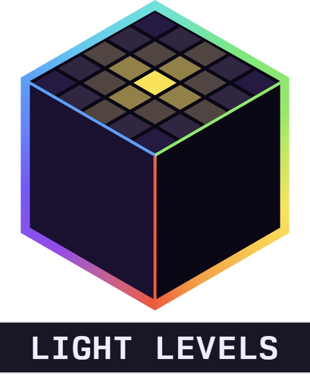

<div align="center">



# Alaydriem's Levels

[](https://github.com/alaydriem/amml-levels/releases)
[](https://github.com/alaydriem/amml-levels/actions/workflows/build.yml)
[](./LICENSE)

[](https://github.com/alaydriem/amml)

</div>

A client-side helper set for Minecraft Bedrock. It has three features:

- Light numbers on the top face of each block where a mob can spawn.
- Chunk borders around you.
- Spawn sphere markers that you drop in the world.

The mod reads data your game already has and sends nothing to the server.

## Features

Hold <kbd>F3</kbd> and press a key. The keys can be changed on the mod manager's Keybinds page.

| Keys | Action |
| --- | --- |
| <kbd>F3</kbd> + <kbd>L</kbd> | Toggle light numbers |
| <kbd>F3</kbd> + <kbd>G</kbd> | Cycle chunk borders: off, 1 chunk, 3×3 chunks |
| <kbd>F3</kbd> + <kbd>J</kbd> | Drop a spawn sphere at your position |
| <kbd>F3</kbd> + <kbd>Shift</kbd> + <kbd>J</kbd> | Remove the nearest spawn sphere |
| <kbd>F3</kbd> + <kbd>Alt</kbd> + <kbd>J</kbd> | Remove all spawn spheres |

### Light numbers

Each spawnable block shows a number on its top face:

| Colour | Light |
| --- | --- |
| Red | 0 |
| Yellow | 1–7 |
| Green | 8–15 |

The number is the light above the block at the current time of day, so open ground reads 15 at noon and lower at night. Numbers update within a quarter second when you place or break a light. They start off in each world.

### Chunk borders

Borders draw on the walls of the chunk you stand in, or on the 3×3 chunks around you. The borders follow you when you
cross into another chunk. They start off in each world.

### Spawn spheres

A dropped sphere shows the mob spawn shell around its center. The inner shell is green at 24 blocks. The outer shell is
red at 44.5 blocks. A sphere is drawn while you are within 96 blocks of its center. Up to 16 spheres can exist at once.
When you drop a 17th, the oldest is removed. Spheres last for one session. They are removed when you leave the world.

The overlays hide with the HUD (<kbd>F1</kbd>).

## Installation

Install it with the [AMML launcher](https://github.com/alaydriem/amml/releases/latest). The launcher also installs the AMML loader and Alaydriem's Mod Manager, which this mod needs.

## Configuration

Settings are in the mod manager panel and saved to `config.hcl` in the mod's config folder. Scan and sphere count
settings apply after a restart.

| Setting | Default | Description |
| --- | --- | --- |
| `keys.toggle` | `"F3+L"` | Toggle light numbers |
| `keys.borders` | `"F3+G"` | Cycle chunk borders |
| `keys.sphere_drop` | `"F3+J"` | Drop a spawn sphere |
| `keys.sphere_remove` | `"F3+Shift+J"` | Remove the nearest spawn sphere |
| `keys.sphere_clear` | `"F3+Alt+J"` | Remove all spawn spheres |
| `borders.line_color` / `borders.center_color` | | RGBA colours, 0–1 |
| `borders.edge_alpha` | `0.69` | Opacity of the chunk edges (0–1) |
| `borders.slime_highlight` | `false` | Draw the borders of slime chunks in green |
| `borders.line_width` / `borders.edge_width` | `0.04` / `0.08` | Line and chunk edge width (half the width and half the alpha under Vibrant Visuals) |
| `spheres.max_markers` | `16` | Most spheres at once (1–64) |
| `spheres.show_distance` | `96.0` | Distance at which a sphere is drawn |
| `spheres.inner_radius` / `spheres.outer_radius` | `24.0` / `44.5` | Shell radii in blocks |
| `spheres.inner_color` / `spheres.outer_color` | | RGBA colours, 0–1 |
| `spheres.spin` | `2.5` | Spin speed of both shells |
| `scan.radius` | `24` | Radius in blocks (1–32) |
| `scan.pass_seconds` | `0.25` | Time for one full scan |
| `scan.max_labels` | `8192` | Max numbers drawn (nearest first) |
| `scan.max_columns_per_frame` | `512` | Max block columns read per frame |
| `light.red_max` | `0` | Highest light shown red |
| `light.yellow_max` | `7` | Highest light shown yellow |
| `label.red` / `label.yellow` / `label.green` | | RGBA colours, 0–1 |
| `label.lift` | `0.02` | Height above the block (0–0.05) |
| `label.scale` | `1.0` | Number size (pixel size, 0.04 block at 1) |
| `telemetry` | `false` | Log frame rate, cost and memory |
| `memory_budget_mb` | `32` | Memory budget |

## Building

Requires Windows x64, [mise](https://mise.jdx.dev), rustup and [cargo-nextest](https://nexte.st). The workspace
depends on the public release tags of `amml` and `amml-modmanager` (git dependencies in `Cargo.toml`); cargo fetches them.

```powershell
mise trust
mise run preflight
mise run check
mise run test
mise run package
```

`mise run package` writes `dist/@alaydriem/levels/` (`alaydriem_levels.dll`, `amml.hcl` and `icon.png`). `mise run install --instance <name>` runs `package`, then copies it into `%LOCALAPPDATA%\amml\instances\<name>\mods\amml\@alaydriem\levels\`. Close the game first.

## License

BSD 3-Clause. Copyright (c) 2026 Charles R. Portwood II. See [LICENSE](./LICENSE).
